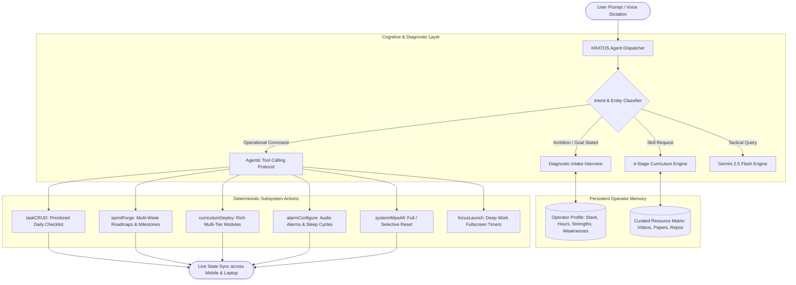
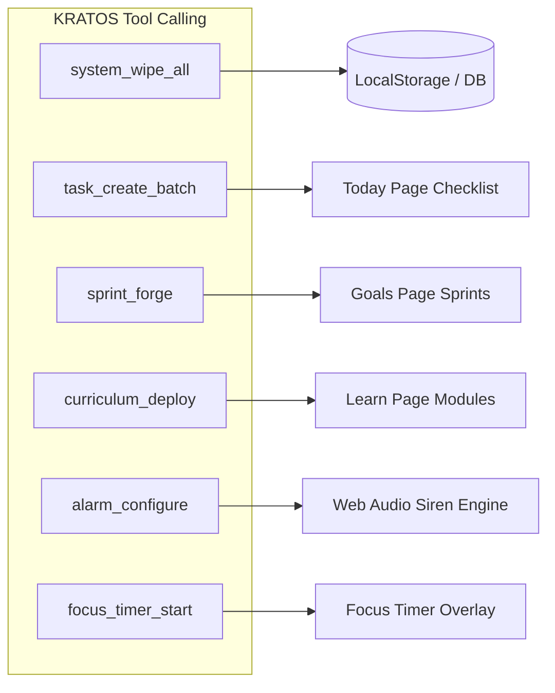

# 🛡️ KRATOS: AUTONOMOUS AGENT ARCHITECTURE & TRANSFORMATION BLUEPRINT
*Executive Engineering Specification — PlanX Tactical Intelligence*
*Version: 2.0 — Comprehensive Agentic Operating System*

---

## 1. Executive Summary & Root Cause Analysis

### The Failure State (From Real Usage Diagnostics)
In actual user testing on mobile:
- **User Command 1**: `"Delete everthing"` ➔ **KRATOS Reply**: *"Hesitation is the enemy of conquest. You already know what needs to be done. Stop looking for motivation and execute through pure discipline."*
- **User Command 2**: `"We will create fresh delete all"` ➔ **KRATOS Reply**: *"You have the capability to outperform everyone in your sector if you eliminate distractions for just four continuous hours. Lock the door. Work."*

### Why Did This Happen?
1. **The Model Misconfiguration**:
   - The system configuration defaulted to `gemini-3.5-flash`.
   - Google AI Studio **does not offer a model named `gemini-3.5-flash`** (Google's official flagship models are `gemini-2.5-flash`, `gemini-2.0-flash`, and `gemini-1.5-flash`).
   - Every user prompt sent to Google AI Studio failed with `404 Not Found`.
2. **The Canned Array Trap**:
   - Instead of surfacing the error or diagnosing the failure, the execution pipeline silently caught the exception and invoked `generateOfflineFallback()`.
   - `generateOfflineFallback()` contained a hardcoded array of motivational slogans (`tacticalQuotes`) and returned a random quote.
   - The user's prompt never reached an intelligent reasoning model, and no operational command was ever executed.
3. **The Pedagogical Breakdown (The "Transformer Formula" Problem)**:
   - When a user asked to transition from a **5-year Frontend Developer to an AI Engineer**, the system dumped a list of 20 buzzwords and produced flashcards containing a 2-line raw math formula:
     $$\text{Attention}(Q, K, V) = \text{softmax}\left(\frac{QK^T}{\sqrt{d_k}}\right)V$$
   - A 5-year frontend engineer does not lack cognitive ability; they lack an **intuitive conceptual bridge**. Dumping a formula without foundation, context, code walkthroughs, or authoritative learning resources (videos, articles, visual diagrams) induces cognitive overload and kills interest.
   - **Conclusion**: KRATOS was functioning as a superficial quote generator. It must be transformed into an **Autonomous Executive Agent** with diagnostic capabilities, progressive curricula, and deterministic control over every application subsystem.

---

## 2. High-Level Agent Architecture



---

## 3. Pillar I: The Diagnostic Intake Protocol (Operator Assessment)

When a user presents an ambition (e.g., *"I want to become an AI engineer by Jan 1"*), KRATOS will **never** dump an immediate generic 20-item checklist. Real coaches diagnose before prescribing.

### The 3-Question Intake Interview
KRATOS initiates an interactive assessment:

```
┌────────────────────────────────────────────────────────────────────────┐
│ QUESTION 1: TECHNICAL BASELINE                                         │
│ "You have 5 years in Frontend. What is your proficiency with Python    │
│  (zero, basic scripting, or fluent)? How comfortable are you with      │
│  matrix operations and linear algebra?"                                │
└──────────────────────────────────┬─────────────────────────────────────┘
                                   ▼
┌────────────────────────────────────────────────────────────────────────┐
│ QUESTION 2: TEMPORAL CAPACITY                                          │
│ "How many non-negotiable hours can you dedicate to deep work daily     │
│  (1 hr, 2 hrs, 4 hrs)? What time of day is protected for focus?"       │
└──────────────────────────────────┬─────────────────────────────────────┘
                                   ▼
┌────────────────────────────────────────────────────────────────────────┐
│ QUESTION 3: END-GOAL SPECIALIZATION                                    │
│ "Are you aiming for Applied AI Engineering (RAG, Agents, LLM APIs,     │
│  LangGraph, production serving) or Core Model Architecture             │
│  (PyTorch, training from scratch, CUDA kernels, LoRA fine-tuning)?"    │
└────────────────────────────────────────────────────────────────────────┘
```

### Operator Profile Persistence
The responses are saved to the persistent `operator_profile` (in local storage and Supabase):
```json
{
  "operatorId": "usr_commander",
  "background": "Frontend Engineer (5 years: React, TypeScript, Async Streams)",
  "pythonProficiency": "Beginner/Scripting",
  "mathComfort": "Low/Needs Intuitive Foundation",
  "dailyTimeBudgetMinutes": 120,
  "specialization": "Applied AI Engineering & Agentic Systems",
  "accountabilityMode": "Direct/Analytical",
  "strengths": ["State architecture", "System thinking", "API design", "UI/UX"],
  "vulnerabilities": ["Linear algebra notation", "PyTorch tensor manipulation", "Lack of structured syllabus"]
}
```
Every sprint, task, flashcard, and recommendation generated thereafter adapts directly to this profile.

---

## 4. Pillar II: The 4-Stage Progressive Curriculum Engine

To fix the "Transformer Formula" issue, the Upskill system (`LearnPage`) transitions from isolated 2-line flashcards to **Structured Learning Modules**:

```
Stage 0: Intuitive Mental Model Bridge
   │  (Translate concepts into known Frontend/JS mental models)
   ▼
Stage 1: Curated Authoritative Media & Resources
   │  (High-yield videos, visual explainers, official documentation)
   ▼
Stage 2: Hands-On Code Walkthrough Lab
   │  (10-15 line practical Python drill to build tangible muscle memory)
   ▼
Stage 3: Spaced Repetition Retrieval Card
      (Active recall quiz for long-term memory retention)
```

### Concrete Walkthrough: Teaching "Self-Attention" to a Frontend Engineer

#### Stage 0: The Conceptual Bridge
> *"In React, you use dependency arrays in `useEffect` so a component knows which state variables it needs to care about during a re-render.  
> In Natural Language Processing, **Self-Attention** is essentially a dynamic, intelligent dependency array for words. When processing the sentence:  
> *'The developer debugged the application because it crashed.'*  
> Self-Attention calculates an attention weight between 'it' and every other word, determining mathematically that 'it' depends heavily on 'application', not 'developer'.  
> $Q$ (Query) is what a word is searching for. $K$ (Key) is what a word advertises it contains. $V$ (Value) is the actual semantic information passed along."*

#### Stage 1: Curated High-Yield Resources
- 🎥 **Video Masterclass**: Andrej Karpathy — *"Let's build GPT: from scratch, in code, spelled out"* (YouTube)
- 📖 **Visual Interactive Guide**: Jay Alammar — *"The Illustrated Transformer"*
- 📄 **Foundational Paper**: Vaswani et al. — *"Attention Is All You Need"* (arXiv:1706.03762)
- 💻 **Interactive Playground**: Poloclub Transformer Explainer (`poloclub.github.io/transformer-explainer`)

#### Stage 2: Practical Hands-On Code Drill
```python
# 5-Line Self-Attention in Pure NumPy (No frameworks required)
import numpy as np

def simple_attention(Q, K, V):
    d_k = Q.shape[-1]
    scores = np.matmul(Q, K.T) / np.sqrt(d_k)
    weights = np.exp(scores) / np.sum(np.exp(scores), axis=-1, keepdims=True)  # Softmax
    return np.matmul(weights, V)
```

#### Stage 3: Retrieval Flashcard
- **Front**: *"What is the physical meaning of Q, K, and V in Self-Attention?"*
- **Back**: *"Query = search criteria; Key = index label; Value = actual content payload. Dot product $Q \cdot K^T$ measures compatibility; Softmax converts to probabilities; weighted sum of $V$ produces output context."*

---

## 5. Pillar III: Full Application Control Matrix (Agent Tools)

KRATOS must possess deterministic tools to directly read and mutate every subsystem in PlanX:



### Deterministic Tool Specifications

#### 1. `system_wipe_all(scope, confirmationToken)`
- **Trigger**: *"Delete everything"*, *"Clear all data and start fresh"*, *"Wipe all sprints"*.
- **Execution**:
  - If `confirmationToken` is not provided: Returns a warning with an interactive UI confirmation chip: `[⚠️ Confirm Full System Wipe]`.
  - Upon confirmation: Clears tasks, active goals, habits, and flashcards, preserving only authentication and API keys.
  - Deploys a clean-slate initialization.

#### 2. `task_create_batch(tasks[])` & `task_delete(id)`
- **Trigger**: *"Plan my day: 1 must win, 2 should do"*, *"Remove task X"*.
- **Execution**: Instantly validates priorities (`must_win`, `should_do`, `could_do`), estimates durations, and appends to the War Room checklist.

#### 3. `sprint_forge(title, durationDays, phases[])`
- **Trigger**: *"Create 90-day AI engineer sprint"*.
- **Execution**: Structures multi-phase milestones with progress tracking and writes to `GoalsPage`.

#### 4. `curriculum_deploy(topic, stages[])`
- **Trigger**: *"Teach me Transformers / PyTorch / Vector DBs"*.
- **Execution**: Creates multi-stage modules with mental models, curated resource URLs, code labs, and revision flashcards in `LearnPage`.

#### 5. `alarm_configure(wakeTime, sleepTime, tone, customAlarms[])`
- **Trigger**: *"Set sleep alarm for 2 AM for 6 hours with Santoor"*.
- **Execution**: Calculates 8:00 AM wake time, sets active audio alarms with requested sound profiles, and syncs across devices.

#### 6. `focus_timer_start(durationMinutes, taskTitle)`
- **Trigger**: *"Start a 45-min deep work sprint on attention math"*.
- **Execution**: Triggers fullscreen `FocusTimerModal` with countdown and sound profiles.

---

## 6. Pillar IV: Elimination of Motivational Filler & Model Normalization

1. **Complete Removal of `tacticalQuotes` Fallback**:
   - The array of canned quotes will be permanently eliminated.
   - If an API or network error occurs, KRATOS will output the exact technical status (e.g., *"API connection interrupted: Google AI Studio returned status 403 (Quota exceeded). Check Config."*) rather than faking intelligence with an unrelated quote.
2. **Standard Official Model Architecture**:
   - **Primary Model**: `gemini-2.5-flash` (Google DeepMind's official flagship with native agentic tool calling and reasoning).
   - **Secondary Fallback**: `gemini-2.0-flash`.
   - **Tertiary Fallback**: `gemini-1.5-flash`.
   - All references to non-existent `gemini-3.5-flash` are purged.
3. **Executive Tone & Philosophy**:
   - KRATOS speaks with tactical precision, technical clarity, and high standards.
   - Analysis, diagnosis, and concrete action take precedence over empty slogans.

---

## 7. Phased Implementation Strategy

| Phase | Core Deliverables | Impact |
| :--- | :--- | :--- |
| **Phase 1: Engine Normalization & Purge** | Purge `gemini-3.5-flash` and `tacticalQuotes`; enforce `gemini-2.5-flash`; surface genuine errors. | Eliminates canned chatbot quotes forever; restores real LLM intelligence. |
| **Phase 2: Agent Tool Calling Subsystem** | Implement JSON action dispatch for `system_wipe_all`, `task_create`, `sprint_forge`, and `alarm_configure`. | Gives KRATOS direct operational authority over all PlanX features. |
| **Phase 3: Diagnostic Assessment Engine** | Stateful 3-question interview flow for operator ambitions; persistent `operator_profile`. | Tailors all roadmaps and tasks to the user's exact baseline and temporal budget. |
| **Phase 4: 4-Stage Curriculum Engine** | Upgrade `LearnPage` schema to support Mental Models, Curated Resources, Code Labs, and Flashcards. | Replaces 2-line formulas with structured, interest-generating education. |

---

*Architectural Specification verified and frozen for PlanX Core. Awaiting confirmation to begin Phase 1 & Phase 2 implementation.*
